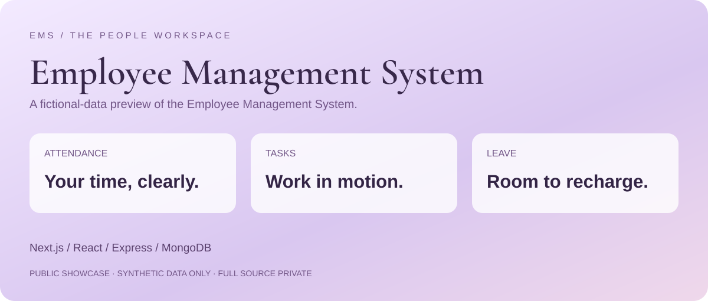
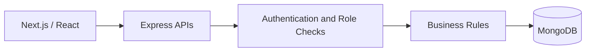

# Employee Management System · Showcase

A public, privacy-safe presentation of my employee management project.

**[Open the interactive preview](https://DeepikaJangid.github.io/EMS-Showcase/)**

The preview is a purpose-built static presentation with fictional names and illustrative numbers. It is not connected to the real application, APIs, database, camera, or location services. It simplifies the real interface and does not calculate attendance or payroll.

## Full Application

- Role-based employee, manager, HR and admin workflows.
- Attendance, approved WFH, leave and task management.
- Monthly summaries, reports and authorized payroll.
- Local, read-only workspace assistant.

**Stack:** Next.js / React · Express / Node.js · MongoDB / Mongoose.

## Architecture

The application source is private. This repository contains only presentation assets and a static demo. No employee records, credentials, payroll records, biometric templates, private URLs, or office coordinates are included.

## Run Locally

Open `index.html` in a browser. No dependencies, login, or server required.
